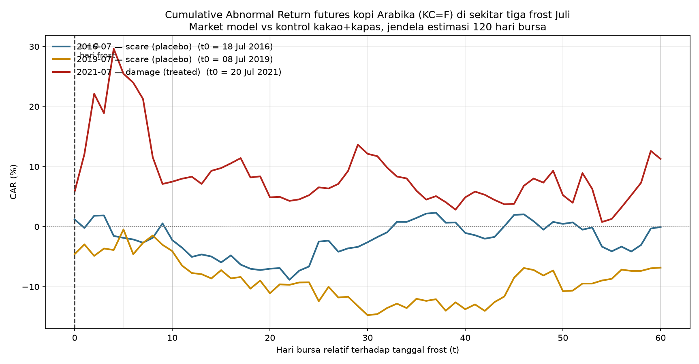
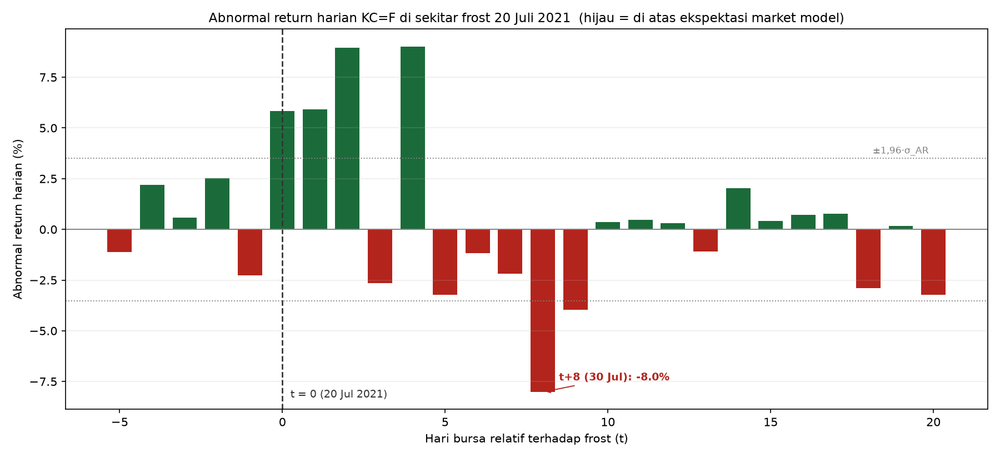
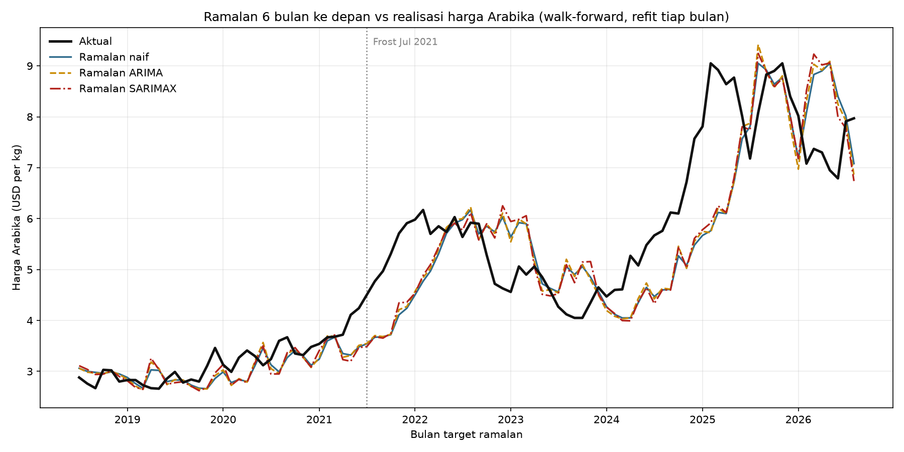

# Coffee Weather Shocks

> Markets price supply destruction, not cold weather.

<!-- RYAN: 2–3 opening sentences. What was studied, what was found, why it matters.
     Use the headline numbers: CAR+5 = +25.5%, t = 5.17, for the 20 July 2021 frost,
     against two frost scares that show no abnormal return. -->

## Findings

### Daily event study: cumulative abnormal return of Arabica futures (`KC=F`)

Control: mean daily return of cocoa (`CC=F`) and cotton (`CT=F`). Estimation window
t−130 to t−11 trading days; CAR summed from t = 0. The same specification is applied to
all three events.

| Event | Model | CAR+5 | CAR+10 | CAR+20 | CAR+60 |
|---|---|---|---|---|---|
| 2016-07 scare (placebo) | Market model | −1.9% (t=−0.43, p=0.67) | −2.2% (t=−0.38, p=0.70) | −7.0% (t=−0.88, p=0.38) | −0.1% (t=−0.00, p=1.00) |
| 2016-07 scare (placebo) | Raw difference | +1.6% (t=+0.34, p=0.74) | +0.6% (t=+0.09, p=0.93) | −1.5% (t=−0.18, p=0.86) | +16.3% (t=+1.04, p=0.30) |
| 2019-07 scare (placebo) | Market model | −0.5% (t=−0.10, p=0.92) | −4.1% (t=−0.65, p=0.51) | −11.1% (t=−1.34, p=0.18) | −6.8% (t=−0.47, p=0.64) |
| 2019-07 scare (placebo) | Raw difference | +0.1% (t=+0.01, p=0.99) | −4.3% (t=−0.64, p=0.52) | −5.0% (t=−0.54, p=0.59) | −4.0% (t=−0.25, p=0.80) |
| **2021-07 damage (treated)** | **Market model** | **+25.5% (t=+5.17, p<0.001)** | +7.5% (t=+1.22, p=0.23) | +4.9% (t=+0.58, p=0.56) | +11.3% (t=+0.76, p=0.45) |
| **2021-07 damage (treated)** | **Raw difference** | **+23.2% (t=+4.45, p<0.001)** | +6.3% (t=+0.96, p=0.34) | +1.9% (t=+0.22, p=0.83) | +14.2% (t=+0.89, p=0.38) |

Event dates (t = 0): 2016-07-18, 2019-07-08, 2021-07-20.
Source: [`notebooks/04_daily_event_study.ipynb`](notebooks/04_daily_event_study.ipynb).

Cross-check against the primary source: `KC=F` closed at 165.65 on 20 July 2021 and 207.80
on 26 July 2021 (+25.45%). The ICO July 2021 report gives 165.65 → 207.8 (+25.4%).

<!-- RYAN: interpret the CAR table. Points to decide on yourself:
     - what CAR+5 shows for 2021 versus the two placebos
     - why CAR falls from +25.5% at t+5 to +7.5% at t+10 (see the daily AR chart:
       t+8 = 30 Jul 2021 alone is 54% of the decline)
     - what that implies for sub-question 3, market efficiency
     State it as "consistent with", not "proves". -->

### Forecasting: walk-forward, refit at every origin

Target `log(arabica_usd_kg)`, errors back-transformed to USD/kg. 103 origins from 2018-01.
Exogenous regressors are lagged and kept only when known at the forecast origin.
The paired test compares each model's absolute error with the naive model's, month by month.

| h (months) | Model | MAE (USD/kg) | RMSE (USD/kg) | MAPE | MAE vs naive | Paired test p | Beats naive in |
|---|---|---|---|---|---|---|---|
| 1 | Naive | 0.254 | 0.357 | 4.8% | 1.000 | — | — |
| 1 | ARIMA | 0.255 | 0.356 | 4.8% | 1.003 | 0.93 | 50% of months |
| 1 | SARIMAX | 0.250 | 0.352 | 4.8% | 0.983 | 0.66 | 53% of months |
| 3 | Naive | 0.519 | 0.684 | 9.6% | 1.000 | — | — |
| 3 | ARIMA | 0.528 | 0.686 | 9.9% | 1.016 | 0.32 | 41% of months |
| 3 | SARIMAX | 0.524 | 0.683 | 9.8% | 1.010 | 0.70 | 46% of months |
| 6 | Naive | 0.719 | 0.991 | 13.0% | 1.000 | — | — |
| 6 | ARIMA | 0.729 | 0.997 | 13.2% | 1.014 | 0.28 | 49% of months |
| 6 | SARIMAX | 0.729 | 0.995 | 13.3% | 1.014 | 0.45 | 44% of months |

Prediction written before any model was run: *the naive baseline will not be meaningfully
beaten*. Source: [`notebooks/05_forecasting.ipynb`](notebooks/05_forecasting.ipynb).

<!-- RYAN: interpret the forecasting table. Was the pre-registered prediction confirmed?
     How large is the only ratio below 1, and what do the paired test and win rate say
     about it? How does this connect to the event study result? -->

## Data & method

| Source | Series | Frequency | Accessed |
|---|---|---|---|
| World Bank Commodity Price Data ("Pink Sheet") <!-- RYAN: add the download URL --> | Coffee, Arabica; Coffee, Robusta (USD/kg) | monthly | by 2026-09-17 (file updated 2026-09-02) |
| [NASA POWER daily point API](https://power.larc.nasa.gov/api/temporal/daily/point) | `T2M_MIN`, `T2M_MAX`, `T2M`, `PRECTOTCORR`, three Arabica regions | daily, 1981– | 2026-09-18 |
| Yahoo Finance via `yfinance` | `BRL=X` | daily → monthly mean | 2026-09-18 |
| Yahoo Finance via `yfinance` | `KC=F` (Arabica), `CC=F` (cocoa), `CT=F` (cotton) | daily, 2015– | 2026-09-20 |
| [ICO Coffee Market Report, July 2021](https://www.ico.org/documents/cy2020-21/cmr-0721-e.pdf) | treated event: 20 July 2021 frost, damage | report | 2026-09-19 |
| [ICO Coffee Market Report, July 2019](https://www.ico.org/documents/cy2018-19/cmr-0719-e.pdf) | placebo: frost scare, no damage | report | 2026-09-19 |
| [ICO Coffee Market Report, July 2016](https://www.ico.org/documents/cy2015-16/cmr-0716-e.pdf) | placebo: frost scare, no damage | report | 2026-09-19 |
| [ICO Coffee Market Report, May 2022](https://www.ico.org/documents/cy2021-22/cmr-0522-e.pdf) | excluded: its pre-period contains the 2021 frost | report | 2026-09-19 |

The full event table, with the ICO wording behind each classification, is in
[`data/events.csv`](data/events.csv).

**Identification.** Events are chosen and classified from ICO reports as either *damage*
(treated) or *scare* (placebo), never from the price response. The day within each event
month is the coldest day across three Brazilian Arabica regions in NASA POWER; for July 2021
that rule returns 20 July, the ICO date. Arabica futures are compared with a cocoa–cotton
control through a market model estimated on the 120 trading days before each event. One
identical specification is run on all three events, so the placebos test whether cold
weather alone moves prices.

Full data specifications, every design decision with its rationale, and everything that was
tried and rejected: [**`docs/methodology.md`**](docs/methodology.md).

## Why the approach changed

The project began as a monthly difference-in-differences on the Arabica–Robusta price gap.
Changing only how the pre-existing trend is controlled moves the estimates:

| Event | Bin | Full-window trend | Pre-only trend |
|---|---|---|---|
| 2021-07 damage | 6–11 months | +11.4% | +7.2% |
| 2021-07 damage | 12–18 months | +1.1% | −3.5% |
| 2019-07 scare | 6–11 months | +7.4% | +19.4% |
| 2019-07 scare | 12–18 months | −1.2% | +14.9% |

No p-values are reported for the monthly design: at n = 31 with one event, no
standard-error estimator is reliable.
Source: [`notebooks/02_causal_did.ipynb`](notebooks/02_causal_did.ipynb).

<!-- RYAN: tell the sequence in your own words. This is the most valuable section.
     - what you tried first, and why it looked reasonable
     - what went wrong: parallel trends fail beyond 18 months, the placebo windows
       overlap, the estimates shift with the trend specification, the standard
       errors broke down
     - what you learned, and why a daily window solves the problem the monthly one
       could not
     The details are in docs/methodology.md §4. -->

## Limitations

- **One treated event.** A single damaging frost in 11 years of daily data; the result does
  not generalise to damaging frosts in general.
- **The 2016-07 placebo is confounded** by a Colombian truckers' strike and BRL moves in the
  same month.
- **The ~50 km weather grid cannot rank severity.** It cannot separate the damaging July 2021
  frost from the minor May 2022 cold snap; no percentile threshold reproduces that ranking.
- **Biennial bearing.** 2021/22 was already an off year in Arabica's two-year production
  cycle, an Arabica-specific factor that moves the treated series and not the control.
- **COVID-19 and Robusta.** Vietnam's July–September 2021 lockdown disrupted Robusta exports,
  lifting the monthly control group in the same months as the frost.
- **Constant σ_AR.** The daily t-test uses pre-event volatility, but Arabica volatility
  spiked after the frost, which makes long-horizon tests too lenient.
- **A weak daily control.** `KC=F` returns correlate 0.18 with the cocoa–cotton control
  (market-model betas 0.21–0.48), so the model removes little common movement.
- **Low power at long horizons.** A CAR+60 of +11.3% cannot be distinguished from zero.
- **The 30 July 2021 price drop** is consistent with the second cold reading not being a
  damaging frost, but profit-taking and month-end positioning are alternative explanations.
- **Forecasting covers one market over 103 origins** and says nothing about other
  commodities or frequencies.
- **FX data gaps.** `BRL=X` is missing before 2006-03, which shortens every regression that
  controls for FX.

Details and sources for each: [`docs/methodology.md` §5](docs/methodology.md#5-limitations).
